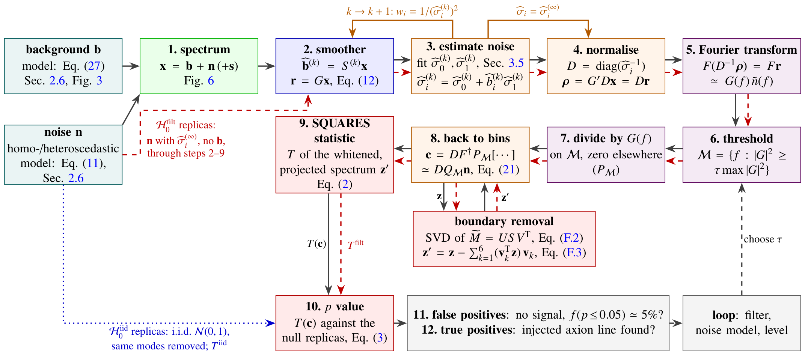

# MadmaxRuns

A signal-agnostic test for narrow lines in power spectra. MadmaxRuns implements *A General
Signal-Agnostic Test for Narrow Signals on Unknown Backgrounds* (S. Mukherjee, A. Caldwell): it
looks for a narrow excess or deficit of **unknown shape** on a large, smooth background of
**unknown shape**, and returns a calibrated frequentist p value. No line shape and no background
model are needed.


---

## Contents

1. [Installation](#1-installation)
2. [The modes](#2-the-modes)
3. [Analysing a real spectrum](#3-analysing-a-real-spectrum)
4. [Analysing a mock spectrum](#4-analysing-a-mock-spectrum)
5. [All options](#5-all-options)
6. [Performance: before and after](#6-performance-before-and-after)
7. [Numerical guarantees](#7-numerical-guarantees)
8. [Verifying an installation](#8-verifying-an-installation)
9. [Paper studies and figures](#9-paper-studies-and-figures)
10. [Batch jobs](#10-batch-jobs)
11. [Troubleshooting](#11-troubleshooting)
12. [File tree](#12-file-tree)

---

## 1. Installation

Requires **Julia 1.12** (the `Manifest.toml` files pin all dependencies).

```bash
git clone <repository-url> MadmaxRuns && cd MadmaxRuns
julia scripts/setup.jl                    # analysis environment
julia scripts/setup.jl plots              # optional: CairoMakie for figures
julia --project=. -t auto test/runtests.jl   # should end with: MadmaxRuns | 474 474
```

Run every command from the repository root. `-t auto` uses all CPU cores; the heavy parts are
parallel, so more threads means a faster run.

```bash
julia --project=. scripts/run_pipeline.jl --help     # short list of all options
```

## 2. The modes

| Mode | Command | Purpose |
|---|---|---|
| **Real spectrum** | `scripts/run_pipeline.jl input=spec.csv` | Analyse a measured spectrum: p value, strongest run, self-calibration, residual check, optional τ scan. |
| **Null validation** | `scripts/validate_nulls.jl dir=spectra/` | Measure the false-positive rate on many real **signal-free** spectra of your instrument (required before a detection claim). |
| **Mock spectrum** | `scripts/run_pipeline.jl model=hetero level=0.05 signal=3` | Simulate a MADMAX-like spectrum (optionally with an axion line) and analyse it with the same chain. For learning, testing and sensitivity estimates. |
| Paper studies | `scripts/run_study.jl <study>` | Reproduce the paper's figures and tables from ensembles of mock spectra (section 9). |

Both spectrum modes use exactly the same analysis chain; only the source of the spectrum differs.

---

## 3. Analysing a real spectrum

### 3.1 Before you run: checklist

The method assumes the following. Check them first; section 3.5 tells you how the code tests them.

- [ ] **Linear power units** (W, counts, arbitrary linear units). Not dB.
- [ ] **One row per frequency bin**, uniformly spaced, frequencies in **Hz**, increasing.
- [ ] **Independent bins.** If the spectrum comes from an FFT with a window function, neighbouring
      bins are correlated; use non-overlapping bins or account for it.
- [ ] **Gaussian noise** in each bin (true for averaged power spectra with many averages).
- [ ] **Noise constant or linear in the background**, σ_i = σ0 + σ1 b_i (radiometer-like).
- [ ] **Smooth background**: varying slowly over the filter window (2m + 1 = 129 bins by default).
- [ ] **No gaps, NaN or Inf.** Known interference lines should be understood before interpreting a
      detection (the test reports *any* narrow excess).
- [ ] **Enough bins**: more than 4m = 256 bins and at least two noise-fit windows of W = 96 bins.

Input file — headerless CSV, `frequency_hz,power`:

```csv
4218000,68.12
4220000,67.94
4222000,68.31
```

A single power column is accepted only with exactly 25 000 bins (it is then placed on the paper's
grid, 4.218 MHz + k·2 kHz). Lines starting with `#` are ignored.

### 3.2 Run

```bash
# Recommended for real data: calibration with 5000 background realisations + residual check
julia --project=. -t auto scripts/run_pipeline.jl input=spec.csv nbkg=5000 check=true

# Quick look (1000 realisations)
julia --project=. -t auto scripts/run_pipeline.jl input=spec.csv nbkg=1000 check=true

# Background unlike the MADMAX model (other instruments, other frequency ranges)
julia --project=. -t auto scripts/run_pipeline.jl input=spec.csv bkg_model=data check=true

# Analysis only, no calibration
julia --project=. -t auto scripts/run_pipeline.jl input=spec.csv calibrate=false

# Also scan the threshold tau for this spectrum (same SG filter), with a trials-corrected p value
julia --project=. -t auto scripts/run_pipeline.jl input=spec.csv nbkg=5000 check=true tauscan=true
```


### 3.3 What happens

| Step | Operation | Paper |
|---|---|---|
| 1 | Read x = b + n (+ s). | Eq. (11) |
| 2 | SG filter (degree n, half-width m): background b̂ = S x, residual r = G x. | Eqs. (12)–(14) |
| 3 | Noise fit σ̂_i = σ̂0 + σ̂1 b̂_i from windowed quadratic fits, iterated with the weighted SG filter until it converges. | Sec. 2.4.2 |
| 4–7 | Normalise by 1/σ̂_i, Fourier transform, keep modes with \|G(f)\|² ≥ τ·max\|G\|², divide by G(f). | Eqs. (7), (21) |
| 8 | Back to bins; z = c/√κ; project out 6 boundary patterns of the finite spectrum. | App. F |
| 9 | SQUARES statistic T = largest χ² of a run of positive bins. | Eq. (2) |
| 10 | p value from P_K. | App. G |
| + | Self-calibration on simulated spectra like yours (and residual check if `check=true`). | Secs. 2.7, 3.7 |



### 3.4 The log, line by line

The log goes to the terminal and to `results/logs/pipeline.log`. A real run (32 threads):

```text
setup: SG filter, n = 4, m = 64, N = 24872, N_g = 24744, q = 0.97274, τ = 1.00e-07, 97 rfft modes removed, κ = 0.99228
steps 2–3: σ̂0 = 1.4821, σ̂1 = 0.0282591 after 4 iterations (converged: true, estimator window)
step 8: boundary singular values 57.53, 10.59, 0.5549, 0.4382, 0.1687, 0.07353
step 9: T = 23.9354 (RunStatistics.t_obs), run 3534–3539 of the tested bins = 11.540000–11.550000 MHz (6 bins)
step 10: p = 0.3049 (log10 p = -0.516) from P_K (order 2); raw residual T = 22.853, p = 0.543 from P_BC
calibration: 1000 background realisations (Eq. (27), ...), noise σ = 1.4821 + 0.0282591 b, axion peak 3.0σ at f - f_ref = 10.5000 MHz, residual check on
calibration: 1000 / 1000 background realisations done (13 s)
calibration: false positives f(p <= 0.05) = 0.0520 ± 0.0069 (expected 0.05), f(p <= 0.01) = 0.0070
calibration: KS distance from flat p = 0.0191, KS p = 0.854; p histogram (20 bins) 52 44 52 62 39 40 58 49 58 51 57 49 50 43 49 49 45 44 57 52
calibration: injected axion line (peak 3.0σ) found in 0.9570 of the mocks
calibration: measured T = 23.9354 lies above 708 of 1000 noise-only mocks, p_bkg = 0.29271
calibration: PASSED, the p values of this chain are flat for spectra like this one
check:   variance           measured +1.0043   mocks median +1.0052, 99.9% range [+0.9998, +1.0107]   deviation   -0.55 sd, p = 0.58 (rank p 0.581)
check:   ...                (eleven diagnostics, see 3.5)
check:   smoothness (App. B): largest relative error of the local noise variance |eps| = 3.62e-04 (limit 1e-02), largest background change across the window Delta = 0.091
check: PASSED, the measured residual is consistent with the assumptions of the method (Gaussian, independent bins, noise linear in a smooth background)
RESULT: CALIBRATED AND CHECKED
RESULT: T = 23.9354, strongest run 11.540000–11.550000 MHz, p(P_K) = 0.3049 (log10 -0.52)
RESULT: p_bkg = 0.2927 from 1000 background realisations
RESULT: significance is calibrated down to p = 1e-04 (P_K) and p = 1.0e-03 (Monte Carlo); smaller p values are not calibrated by this run
RESULT: before claiming a detection, validate the false-positive rate on signal-free instrument spectra (scripts/validate_nulls.jl) and correct for the number of spectra searched
```

| Line | Meaning | What to look for |
|---|---|---|
| `setup` | N analysed bins, N_g tested bins, q (noise fraction passing the filter), removed modes, κ (kept fraction). | – |
| `steps 2–3` | Fitted noise model and iterations. | σ̂1 ≈ 0: homoscedastic noise. `converged: false` stops the run. |
| `step 8` | Strength of the six boundary patterns removed. | – |
| `step 9` | **T** and the strongest run: tested-bin indices (file row = index + 2m), its frequency range and width. | Location of a candidate (for an axion: the frequency to re-measure). |
| `step 10` | **p from P_K** — the result. The raw-residual p (no whitening) is shown for comparison only; it is biased towards 1 by the filter correlation. | "beyond the validated range" appears for p < 1e-4 (section 7). |
| `calibration: false positives` | Fraction of signal-free simulated spectra with p ≤ 0.05, with binomial error. | ≈ 0.05 |
| `calibration: KS ...` | Flatness of their p values; 20-bin histogram. | KS p not small, flat histogram |
| `calibration: injected ...` | Detection rate for an axion line of 3σ peak. | Your sensitivity |
| `calibration: measured T ... p_bkg` | **Monte Carlo p value** of your spectrum; "p_bkg <" when no realisation reaches T (resolution limit). | Close to the P_K p if all is well |
| `calibration: PASSED/FAILED` | Verdict, section 3.5. | PASSED |
| `check: ...` | Eleven diagnostics of your residual vs. the simulated ones and the App. B smoothness test, section 3.5. | PASSED, no `<- FLAGGED` |
| `tau scan` | T and p at each τ for your spectrum; per-τ false-positive and detection rates of the realisations; trials-corrected p_scan (section 3.6). | Stable p across τ |
| `RESULT` | Final status, the candidate, all p values, and down to which p the significance is calibrated. | `CALIBRATED AND CHECKED` |

### 3.5 Is the result trustworthy?

**Self-calibration (always on, `calibrate=true`).** `nbkg` simulated spectra are built from your
spectrum's fitted noise model and either the paper's background model (Eq. 27 with random
parameters, scaled to your background level; `bkg_model=paper`) or your own fitted background
(`bkg_model=data`). Each is analysed with exactly your settings, once without signal and once with an
injected axion line. **PASSED** requires:

| Criterion | Threshold |
|---|---|
| false-positive rate f(p ≤ 0.05) | within 3 binomial errors of 0.05 (±0.009 for nbkg = 5000) |
| flatness of the p values | Kolmogorov–Smirnov p > 0.01 |
| failed simulated chains (noise fit not converged or non-positive) | ≤ 1 % |

Failed chains are handled conservatively: they count as false positives in the rates and as
realisations reaching your T in p_bkg, so leaving them out can never make a result look more
significant. Only genuine noise-fit failures are counted; any other error (a bug, memory) stops the
run.

The calibration shows that the **method** is calibrated for spectra like yours. It cannot show that
your **data** obey the assumptions, because the simulations are built from those assumptions.

**Residual check (`check=true`, recommended for real data).** Your residual is compared with
those of the signal-free simulations, one diagnostic per assumption of the paper. Each is an average
over ~25 000 bins (or ~260 windows), so its spread over the simulations is Gaussian to good
approximation; your value is reported as a deviation d in standard deviations with p = 2Φ(−|d|),
flagged when p < 1e-3 (|d| > 3.3). Diagnostics that a localised line would also change are computed
away from the strongest run (±2m bins), in your data and in every simulation alike.

| Diagnostic | Paper assumption tested | Flagged typically by |
|---|---|---|
| `variance` | noise level fitted correctly (Eqs. 15–18) | wrong noise model, non-linear units |
| `skewness` | Gaussian, symmetric noise (Eq. 1) | non-Gaussian noise, many lines |
| `excess_kurtosis` | Gaussian tails (Eq. 1) | heavy-tailed noise, spikes, interference |
| `lag1_autocorr` | independent bins; filter correlation removed (Sec. 2.3) | correlated bins (FFT window functions) |
| `autocorr_rms` | no correlation at lags 2–250 (the measure of Fig. 10) | longer-range correlations, standing waves |
| `noise_slope` | noise linear in the background (Eq. 11) | σ ∝ √b, σ ∝ b² |
| `noise_curvature` | no non-linear noise dependence (Eq. 11) | curved σ(b) |
| `window_dispersion` | stationary noise | bursts, gain drifts |
| `leakage` | background removed by the filter (App. B, sliding mean of r/σ̂ over 2m + 1 bins) | features narrower than the filter window, kinks, steps |
| smoothness | App. B, Eq. (B.2): relative error ε of the local noise variance ≤ 1 % | background or noise changing too fast within the window |
| `max_z`, `neg_min_z` | (notes, not in the verdict) | a real line, a dip or a glitch |
| run width | (note) the signal is narrow | a run wider than m bins: a broad feature, partly absorbed by the filter |

With 9 diagnostics at p < 1e-3, a spectrum that satisfies every assumption is flagged by chance in
about 1 % of cases.

Tested on synthetic "real" spectra (1000 realisations each):

| Spectrum | P_K p | Calibration | Check |
|---|---|---|---|
| Gaussian noise, linear model (7 spectra) | 0.30, … | PASSED | PASSED (all 7) |
| + axion line of 6σ peak (a real signal) | 2e-29 | PASSED | PASSED, `max_z` noted |
| Student-t noise (heavy tails), **no signal** | 2e-27 (false!) | PASSED | **FAILED**: kurtosis +116 sd, window dispersion +18 sd |
| noise ∝ √b, no signal | 0.43 | PASSED | **FAILED**: curvature −12 sd, slope −5.5 sd, variance −4.8 sd |

The third row is why `check=true` matters: bad data can produce a confident false detection that
only the check catches. The second row shows that a genuine narrow line does not trip it.

### 3.6 The τ scan (`tauscan=true` or `taus=...`)

The single-spectrum analysis uses one fixed τ (default 1e-7). With the boundary term removed every
small τ is valid, and a smaller τ keeps more of a narrow line (paper Sec. 3.7, Fig. 11). The τ scan
repeats steps 4–10 for your spectrum at each τ of a list (default 1e-7, 1e-6, …, 1e-2, 0.05, 0.2),
with the same SG filter and the same noise fit, and prints T, p and the run location at each τ.

Choosing the τ with the smallest p is a choice among several (correlated) tests, so that smallest p
is too optimistic. With the calibration on, the same scan is repeated on every simulated spectrum
and **p_scan** — the fraction of signal-free realisations whose smallest p over the scan is at
least as small as yours — is the trials-corrected significance. The calibration also prints the
false-positive and detection rate at each τ. A clean spectrum at 5 % heteroscedastic noise
(1000 realisations):

| τ | 1e-7 | 1e-6 | 1e-5 | 1e-4 | 1e-3 | 1e-2 | 0.05 | 0.2 |
|---|---|---|---|---|---|---|---|---|
| false positives (±0.007) | 0.052 | 0.054 | 0.058 | 0.055 | 0.060 | 0.058 | 0.054 | 0.053 |
| 3σ axion line found | 0.957 | 0.952 | 0.938 | 0.910 | 0.885 | 0.831 | 0.767 | 0.683 |

Every τ is calibrated and the smallest τ detects most, as in the paper. A real signal shows a small
p at all small τ; a p that is small at one τ only is a warning sign. Recommended: keep the default
τ = 1e-7 for the decision (fixed in advance, no trials) and use the scan as a stability check.

### 3.7 Which p value to report

| Situation | Report |
|---|---|
| Calibration PASSED and check PASSED | **p from P_K** (step 10). p_bkg should agree within its Monte Carlo error. |
| τ chosen from a scan | **p_scan** (trials-corrected), not the smallest p. |
| p from P_K < 1e-4 | Beyond the range validated against Monte Carlo: a conservative extrapolation, **not calibrated** (section 7). p_bkg cannot go below 1/(nbkg + 1). Quote "p < 1e-4" unless a dedicated Monte Carlo or instrument validation reaches further. |
| Calibration FAILED, check PASSED | P_K is not calibrated for such spectra: investigate (section 11). p_bkg uses the same simulations and is only a cross-check. |
| Check FAILED | The data violate the assumptions: **no p value is reliable** until the cause is fixed. |

When many spectra are searched, correct for the number of spectra (look-elsewhere effect).

### 3.8 Validating on signal-free instrument data

The calibration and the check use simulated spectra built from the method's assumptions; they cannot
reveal an instrument effect that neither the simulations nor the diagnostics contain. The decisive
test is a set of **real spectra that contain no signal** — taken with the signal path blocked, in an
off-resonance configuration, or in a frequency range already excluded — analysed with exactly the
settings of the search:

```bash
julia --project=. -t auto scripts/validate_nulls.jl dir=path/to/signal_free_spectra
```

It runs the chain on every CSV in the directory (one filter setup per frequency grid, all spectra in
parallel), counts failed noise fits as positives, and reports f(p ≤ 0.05) with its binomial error,
f(p ≤ 0.01), the KS test against a flat distribution and the p histogram, plus a CSV with T, p, the
noise fit and the run frequencies of every spectrum (`results/data/null_validation.csv`). Use a few
hundred independent spectra: with N spectra the false-positive rate is known to ±3·√(0.05·0.95/N).
Tested: 300 simulated clean spectra give 0.053 ± 0.013 (PASSED, 13 s); 100 heavy-tailed spectra
give 1.00 (FAILED).

### 3.9 Protocol for a detection claim

1. Fix the settings in advance (SG n, m; τ = 1e-7; K = 6). Do not tune them on the data.
2. Validate the false-positive rate on signal-free instrument spectra (3.8).
3. Run each spectrum with `nbkg=5000 check=true`; require calibration and check PASSED.
4. Correct for the number of spectra searched (and use p_scan if τ was scanned).
5. Quote significance only down to the validated level (p ≥ 1e-4 from P_K, ≥ 1/(nbkg + 1) from p_bkg,
   or further with a dedicated Monte Carlo); beyond it state "significance not calibrated at this level".
6. For an axion candidate: re-measure at the reported frequency; a real axion line persists and
   moves with the expected line shape, an artefact does not.

### 3.10 What the package cannot do for you

Two steps lie outside any code and are the user's responsibility:

1. **Validation on real signal-free instrument data — required for every detection claim.** The
   self-calibration and the check use simulated spectra built from the method's assumptions, so they
   cannot reveal an instrument effect that neither the simulations nor the diagnostics contain
   (interference, gain drifts, correlations specific to your readout). Run `validate_nulls.jl` (3.8)
   on a few hundred independent spectra that contain no signal, taken with exactly the settings of the
   search, and require f(p ≤ 0.05) ≈ 0.05 within its error and flat p values. Until this has passed,
   a small p value is a candidate, not a detection.

2. **Significance below p = 1e-4 — only needed for strong signals (beyond about 3.7σ).** P_K is
   validated against Monte Carlo down to p = 1e-4 (App. G); below that the package reports a
   conservative extrapolation and marks it as not calibrated, and p_bkg cannot go below
   1/(nbkg + 1). To quote a smaller p, calibrate the tail with a dedicated Monte Carlo of the same
   chain: about 10/p replicas are needed to resolve p (e.g. ≥ 1e6 for 1e-5), via `nbkg` or `nfilt`
   on a cluster (section 10), or with a correspondingly large set of signal-free instrument spectra.
   Ordinary results and borderline candidates (p ≥ 1e-4) do not need this.

### 3.11 Output files

```text
results/
├── logs/pipeline.log                        append-only log
└── data/
    ├── measured_<signature>.jls             final result
    └── checkpoints/<signature>/             resumable stage checkpoints
```

```julia
using MadmaxRuns
r = MadmaxRuns.load_result("results/data/measured_<signature>.jls")
r.result.T, r.result.p_pk, r.log10p          # statistic, P_K p value, log10 p (exact also below 1e-308)
r.result.run                                  # first and last tested bin of the strongest run
r.result.noise.sigma0, r.result.noise.sigma1  # fitted noise model
r.result.zp                                   # whitened, boundary-projected residual
r.calibration.p_bkg, r.calibration.calibrated # Monte Carlo p value, calibration verdict
r.calibration.fp05, r.calibration.ks_p, r.calibration.tp05, r.calibration.hist
r.calibration.check.passed, r.calibration.check.rows   # residual check (nothing if check=false)
r.calibration.check.smooth, r.calibration.check.run_width
r.calibration.scan.p_scan, r.calibration.scan.fp_tau, r.calibration.scan.tp_tau   # tau scan (if requested)
r.tauscan                                     # T, p and run frequencies at each tau
r.run_frequency_hz, r.summary.status          # candidate frequency range, final status
```

**Resuming.** Every stage, and every block of 128 simulated spectra, is checkpointed. Rerun the same
command after an interruption and it continues; the checkpoint signature covers the data, all
options and the code, so any change starts afresh. `resume=false` forces a recomputation.

---

## 4. Analysing a mock spectrum

Without `input=` the program simulates a spectrum with the paper's model (25 000 bins of 2 kHz from
4.218 MHz, background of Eq. 27, noise σ_i = σ0 + σ1 b_i) and analyses it with the same chain,
including the calibration:

```bash
julia --project=. -t auto scripts/run_pipeline.jl model=homo   level=0.05              # noise only
julia --project=. -t auto scripts/run_pipeline.jl model=hetero level=0.05 signal=3     # + axion line, 3σ peak
julia --project=. -t auto scripts/run_pipeline.jl model=hetero level=0.173 signal=3 seed=7
```

| Option | Values | Meaning |
|---|---|---|
| `model` | `homo`, `hetero` | σ1 = 0, or radiometer-like noise with σ0 = σ_med/√5 |
| `level` | e.g. `0.0012`, `0.01`, `0.05`, `0.173` | noise level σ/b_med (the paper's four levels) |
| `signal` | peak in σ_i, `0` = none | axion line at f − f_ref = 10.5 MHz |
| `seed` | integer | reproducible realisation |

Use it to see what a detection looks like, to estimate the sensitivity for a given noise level, or
to check an installation.

---

## 5. All options

`key=value`; unknown keys stop the run; `--help` prints a summary.

| Option | Default | Meaning |
|---|---|---|
| **Input/output** | | |
| `input` | – | CSV spectrum (real mode). Omit for mock mode. |
| `output_root` | `results` or `$MADMAX_OUT` | Root of `logs/`, `data/`, `paperplots/`. |
| `out` | `data/measured_<sig>.jls` | Result file; `out=` (empty) skips it. |
| `log` | `logs/pipeline.log` | Log file (appended). |
| `checkpoint_dir` | `data/checkpoints` | Checkpoints. |
| `resume` | `true` | Reuse checkpoints of an identical run. |
| **Analysis** | | |
| `n`, `m` | `4`, `64` | SG degree and half-width. |
| `kind` | `SG` | `SG` or `SGW` (cos⁴-weighted SG). |
| `tau` | `1e-7` | Fourier threshold τ. With boundary removal, smaller τ keeps more of a line (paper Fig. 11). |
| `K` | `6` | Boundary patterns removed; `0` disables the removal. |
| `W` | `96` | Noise-fit window. |
| `estimator` | `window` | `window` or `lsq`. |
| `maxit`, `tol` | `60`, `1e-10` | Noise-fit iteration limit and tolerance. |
| `pk_order` | `2` | Order of the E_q closed form (2 = paper). |
| `seed` | `2026` | Seed for all random streams. |
| **Calibration and check** | | |
| `calibrate` | `true` | Self-calibration. |
| `nbkg` | asked / `5000` | Simulated spectra; ≥ 1000 recommended for `check=true`. |
| `bkg_model` | `paper` | `paper` (Eq. 27, scaled) or `data` (your fitted background). |
| `calib_signal` | `3` | Peak of the injected line in σ_i; `0` skips. |
| `check` | `false` | Residual check of the measured spectrum (needs `calibrate=true`). |
| `tauscan` | `false` | Repeat the analysis at τ = 1e-7, 1e-6, …, 1e-2, 0.05, 0.2 (section 3.6). |
| `taus` | – | Own list of τ for the scan, e.g. `taus=1e-7,1e-5,1e-3`. |
| **Monte Carlo nulls** | | |
| `nnull` | `0` | H0^iid replicas (unit Gaussians, same modes removed). |
| `nfilt` | `0` | H0^filt replicas (your σ̂_i, same chain). |
| `filt_reestimate` | `false` | Re-fit noise on H0^filt replicas (diagnostic only). |
| **Mock mode** | | |
| `model`, `level`, `signal` | `homo`, `0.05`, `0` | Section 4. |

---

## 6. Performance: before and after

Measured on one 32-core node (Julia 1.12, 32 threads).

| Task | Before | After | Speed-up |
|---|---|---|---|
| One chain (noise fit → p value), 1 thread | 109 ms | 83 ms | 1.3× |
| 64 chains in parallel, 32 threads | 28.6 s | 1.5 s | 19× |
| Calibration, 1000 realisations (2000 chains) | ≈ 15 min | 13 s | ≈ 70× |
| Calibration, 5000 realisations (default) | ≈ 70 min | ≈ 65 s | ≈ 65× |
| Whole real-spectrum run, `nbkg=5000 check=true` | ≈ 70 min | ≈ 1.5 min | ≈ 45× |
| … with `tauscan=true` (8 τ on every realisation) | (new feature) | ≈ 6 min | – |
| Null validation, 300 spectra (`validate_nulls.jl`) | – | 13 s | – |

The old code got *slower* with more threads (8 threads: 3× slower than 1). Three shared locks were
responsible; all three were removed without changing the mathematics:

1. **FFT plans.** `rfft`/`irfft` built a new FFTW plan on every call, and plan creation holds a global
   lock. Plans are now created once per length and reused (`src/whitening/fftplans.jl`); executing a
   plan is thread-safe.
2. **Small linear solves.** The weighted SG filter solves a 5×5 system in each of ~25 000 bins, the
   noise fit a 3×3 system per window, through LAPACK, whose tiny calls serialise across threads. They
   are now solved by the same Cholesky factorisation written in Julia. The weighted SG filter agrees
   with a direct per-window least-squares fit to 1e-12.
3. **SQUARES statistic.** `RunStatistics.t_obs` took 10 ms per spectrum; one linear scan of the runs
   takes 0.03 ms and gives the identical T (bit for bit on 3000 test spectra). For the analysed
   spectrum both are computed and must agree; simulations use the scan.

In addition, the weighted SG filter reuses its FFT buffers (allocation per chain 58 → 36 MB).
**Results are unchanged**: fitted noise, T and p agree with the previous code to 1e-13, the null
replicas bit for bit.

---

## 7. Numerical guarantees

* **P_K is defined for every T and every τ** (tested: T = 1–400, τ = 1e-7 to 0.5; monotone in T).
* **Down to p = 1e-4** — the range the paper validates against Monte Carlo — p is Eq. (G.4) exactly
  (to 1e-14).
* **Long runs:** where the closed form of E_q breaks down, E_q = 0 as the paper states, accepted
  only if those run lengths carry < 1e-4 of the weight (p changes by < 0.01 %); otherwise an error.
* **Below p = 1e-4:** neither Eq. (G.4) nor anything else in the paper is validated there. The code
  holds the correction factor p_K/p_BC at its value at p = 1e-4 and uses the exact P_BC. Since the
  factor of Eq. (G.4) decreases with T, this gives a larger p than the formula would (conservative),
  but it is an **extrapolation, not a calibration**; the log and the RESULT lines say so.
* **Very small p:** computed in log space; p < 2.2e-308 is stored as 2.2e-308, with the exact log10 p
  in the log and the result file.
* **Monte Carlo resolution:** p_bkg and p_scan never go below 1/(nbkg + 1); when no realisation
  reaches the measured value they are reported as upper limits ("<").
* **Failures are loud:** invalid input, a non-converged noise fit, a non-positive noise level, an
  invalid P_K or a T mismatch with RunStatistics stop the run with a message; nothing is silently
  clipped.

---

## 8. Verifying an installation

```bash
julia --project=. -t auto test/runtests.jl     # 474 tests, about 1 min
julia --project=. -t 4 scripts/selftest.jl     # tests + a quick run of every study
julia --project=. -t auto scripts/run_pipeline.jl model=hetero level=0.05 nbkg=1000 check=true
```

The last command should report `calibration: PASSED` and `check: PASSED`, a false-positive rate near
0.05 and a line detection rate near 0.96.

The unit tests cover every step: model, filters, noise fit, whitening, boundary removal, P_BC
(against RunStatistics and an independent recursion), the moments of E_q, P_K over the full T range
at several τ, the cached FFTs, the Cholesky solver, the run scan, checkpoints, the studies, and the spectrum mode end
to end (calibration, check, τ scan, option errors, null validation).

---

## 9. Paper studies and figures

The study mode reproduces the paper from large mock ensembles. It does not analyse real data.

| Studies | Paper output |
|---|---|
| `filter`, `background`, `spectra`, `sigmafit`, `iteration` | filter response, spectra, noise fits, convergence (Figs. 1–3, 6, 7) |
| `nobkg`, `examples`, `leakage`, `tolerance`, `boundary` | detections, line shapes, leakage, boundary (Figs. 4, 5, 12, 14, B.15, F.18) |
| `tauscan`, `tau0`, `correlation`, `fptp`, `pvalues`, `tcut` | thresholds, correlations, p-value calibration, P_K (Figs. 8–11, E.16–E.17, G.19–G.20, H.21) |
| `table_a`, `table_b` | Table 1 |

```bash
julia --project=. scripts/run_study.jl list
julia --project=. -t 32 scripts/run_study.jl tauscan outdir=results/data resume=true
julia --project=. -t 4  scripts/run_study.jl all quick=true outdir=smoke
julia --project=plots plots/scripts/run_paper_notebook.jl        # figures into results/paperplots
```

[paperplot.ipynb](paperplot.ipynb) holds one cell per paper figure; it reads `results/data/` and
writes `results/paperplots/`. `resume=true` reuses verified completed studies.

---

## 10. Batch jobs

Edit `batch/config.sh` (queue, cores, memory, walltime; all paths are relative to the repository)
and submit:

```bash
bash batch/pbs_paper.sh       # full paper studies + figures (PBS)
bash batch/pbs_all.sh         # staged studies, table merge, figures (PBS)
bash batch/run_local.sh 32    # the same on one machine, no scheduler

# one real spectrum as a PBS job
qsub -v CMD="--project=$PWD scripts/run_pipeline.jl input=$PWD/spec.csv nbkg=5000 check=true" batch/pbs_single.sh
```

PBS logs go to `results/logs/pbs`. Stages are chained with `afterok`: if a sub-job fails, PBS deletes
the dependent stages; fix the cause and resubmit the failed and later stages (`resume=true` reuses
everything that finished).

---

## 11. Troubleshooting

| Message | Cause and remedy |
|---|---|
| `frequencies must be strictly increasing and uniformly spaced in Hz` | Resample onto a uniform grid; check the unit. |
| `power-only CSV must have 25000 rows` | Add the frequency column. |
| `noise fit did not converge` | The noise model does not describe the spectrum. Check units, mask strong features, try `estimator=lsq` or a larger `maxit`. Diagnostics are saved as `noise_fit.failed.jls.gz`. |
| `fitted noise must be finite and strictly positive in every bin` | σ̂0 + σ̂1·b̂ < 0 somewhere: noise not linear in the background, or an offset in the power. |
| `calibration: FAILED (... not flat)` | P_K not calibrated for such spectra: report p_bkg; run `check=true`; try `bkg_model=data`. |
| `calibration: FAILED (... chains failed)` | The noise fit fails on > 1 % of spectra like yours: see the two rows above. |
| `check: FAILED` | See the flagged diagnostic in section 3.5. |
| `check needs at least 100 analysed noise-only mocks` | Increase `nbkg`. |
| `smoothness ... <- FLAGGED` | The background or noise changes too fast within 2m + 1 bins: use a smaller `m` or a higher `n`, or mask the feature. |
| `validate_nulls: FAILED` | Signal-free instrument spectra are not flat: the instrument violates an assumption; run single spectra with `check=true` to find which. |
| `cannot lock ...` | The same run is active in another process. |
| H0^filt p values pile up near 1 with `filt_reestimate=true` | Expected: with b = 0 the noise model cannot be re-fitted. Keep the default. |

---

## 12. File tree

```text
MadmaxRuns/
├── Project.toml                      analysis package: name, dependencies, compatible versions
├── Manifest.toml                     exact pinned dependency versions (Julia 1.12)
├── README.md                         this documentation
├── paper.pdf                         the paper this code implements
├── paperplot.ipynb                   notebook with one cell per paper figure (kernel "MadmaxRuns (Julia)")
├── Madmax_Runs-3.ipynb               earlier SQUARES workflow notebook, kept for reference
├── .gitignore                        excludes results, smoke runs and checkpoints from git
├── .gitattributes                    marks notebooks as documentation (GitHub reports the repository as Julia)
├── docs/
│   └── figure-13-analysis-pipeline.png   pipeline diagram (paper Fig. 13) shown in this README
├── notebooks/
│   ├── Project.toml                  environment of the Jupyter kernel (IJulia + plots)
│   └── Manifest.toml                 its pinned versions
├── scripts/
│   ├── run_pipeline.jl               spectrum mode CLI: real (input=) or mock spectrum, full chain, RESULT
│   ├── spectrum_calibration.jl       self-calibration on simulated spectra, residual check, tau-scan calibration
│   ├── validate_nulls.jl             false-positive rate on a folder of signal-free instrument spectra
│   ├── run_study.jl                  study mode CLI: run one paper study (or all) by name
│   ├── setup.jl                      installs the environments (analysis, plots, Jupyter kernel)
│   ├── selftest.jl                   unit tests plus a quick run of every study
│   ├── merge_tables.jl               merges the per-shape/width Table 1 parts into one table
│   └── latex_table.jl                writes Table 1 as LaTeX (table_shapes4.tex)
├── src/
│   ├── MadmaxRuns.jl                 module definition: includes all files, exports the public API
│   ├── model/
│   │   ├── grid.jl                   frequency grid (25 000 bins of 2 kHz from 4.218 MHz) and bin lookup
│   │   ├── background.jl             MADMAX-like background, Eq. (27), with random parameters r_k
│   │   ├── noise.jl                  noise model sigma_i = sigma0 + sigma1 b_i, homo-/heteroscedastic, Eq. (11)
│   │   └── lineshapes.jl             Gaussian, Lorentzian, top-hat and axion (SHM) lines, Eqs. (22)-(26), (D.1)
│   ├── filter/
│   │   ├── savitzky_golay.jl         SG/SGW kernels, residual kernel g, transfer function G(f), residual r = Gx
│   │   └── weighted_sg.jl            SG filter with per-bin weights 1/sigma_i^2 (noise-fit iteration)
│   ├── noise/
│   │   └── estimate.jl               windowed and least-squares noise fits, iteration to convergence (Sec. 2.4.2)
│   ├── whitening/
│   │   ├── fftplans.jl               cached thread-safe FFT plans and the small Cholesky solver (speed)
│   │   └── fourier.jl                Fourier mask M (threshold tau), kappa, division by G(f)
│   ├── boundary/
│   │   ├── boundary.jl               boundary-term patterns of the finite spectrum and their projection (App. F)
│   │   └── tau0.jl                   lower bound tau0 on the threshold, exact and closed form (App. E)
│   ├── stats/
│   │   ├── squares.jl                SQUARES statistic T (Eq. 2) and P_BC, its distribution for i.i.d. bins (Eq. G.1)
│   │   ├── pk.jl                     P_K, the distribution corrected for removed modes (App. G), tail rules
│   │   ├── pk_exact.jl               exact E_q by Monte Carlo (Eq. G.3), for validating the closed form
│   │   ├── special.jl                chi^2 tail functions (also in log space), normal CDF and quantile
│   │   └── bivariate_normal.jl       bivariate normal CDF Phi_2 used in the second-order E_q (Eq. G.5)
│   ├── pipeline/
│   │   ├── config.jl                 PipelineConfig: all analysis settings with defaults
│   │   ├── setup.jl                  FilterSetup: everything that depends only on filter and tau (G, mask, P_K, boundary)
│   │   └── chain.jl                  run_chain (steps 2-10) and simulate_spectrum (step 1)
│   ├── nulls/
│   │   └── nulls.jl                  H0^iid and H0^filt replicas and Monte Carlo p values
│   ├── io/
│   │   ├── checkpoints.jl            stage checkpoints, run signatures, file locks (resume)
│   │   ├── results.jl                saving/loading results, CSV output, output folder layout
│   │   ├── logging.jl                time-stamped log to terminal and file
│   │   ├── cli.jl                    key=value parsing for the study CLI
│   │   └── parallel.jl               thread settings (FFTW and BLAS at one thread per Julia thread)
│   └── studies/                      one file per group of paper figures/tables (study mode)
│       ├── common.jl                 shared options, random streams, thresholds, helpers of all studies
│       ├── registry.jl               study names, quick settings, run_study with verified resume
│       ├── filter_study.jl           Fig. 1: SG kernels and transfer functions
│       ├── spectra.jl                Figs. 3, 6: backgrounds and simulated spectra
│       ├── noise_studies.jl          Figs. 2, 7: noise-fit convergence and noise estimates
│       ├── nobkg.jl                  Figs. 4, 5: SQUARES without background, four line shapes
│       ├── tables.jl                 Table 1 (a) without and (b) with background
│       ├── correlation.jl            Figs. 8-10: correlation matrices, tau scan of the autocorrelation, tau_min
│       ├── boundary_study.jl         Figs. E.16-E.17, F.18: tau0, boundary patterns and their removal
│       ├── fptp.jl                   Fig. 11: false- and true-positive rates against tau
│       ├── leakage.jl                Fig. 12: background leakage against filter degree and width
│       ├── examples.jl               Fig. 14: the full pipeline on one spectrum per noise model
│       ├── tolerance.jl              Fig. B.15: tolerance of the local-smoothness approximation (App. B)
│       ├── tcut.jl                   Figs. G.19-G.20: T distribution after the mode cut, P_K vs Monte Carlo
│       └── pvalues.jl                Fig. H.21: p-value distributions under both null hypotheses
├── plots/
│   ├── Project.toml                  plotting package (CairoMakie) environment
│   ├── Manifest.toml                 its pinned versions
│   ├── src/
│   │   ├── MadmaxRunsPlots.jl        plotting module and make_all (all figures from the study results)
│   │   ├── style.jl                  paper theme, colours, labels, PDF/PNG saving
│   │   ├── figures_model.jl          filter, noise-fit convergence, background, spectra, noise estimates
│   │   ├── figures_tests.jl          no-background tests, line shapes, correlations, tau scan, FP/TP, p values
│   │   ├── figures_chain.jl          pipeline example (Fig. 14), leakage, tolerance, tau0, boundary, P_K vs Monte Carlo
│   │   └── paper.jl                  numbered paper-figure export with the required ensemble sizes
│   └── scripts/
│       ├── make_figures.jl           exports all figures as PDF and PNG
│       └── run_paper_notebook.jl     executes paperplot.ipynb and saves the numbered figures
├── batch/
│   ├── config.sh                     queue, cores, memory, walltime, paths (edit for your cluster)
│   ├── pbs_paper.sh                  submits the full paper run: studies, scans, figure export
│   ├── pbs_all.sh                    submits the staged run: self-test, stage 1, stage 2, merge and figures
│   ├── pbs_array.sh                  one PBS sub-job = one line (study + options) of a job list
│   ├── pbs_single.sh                 one PBS job running any Julia command (CMD=...)
│   ├── pbs_finish.sh                 final stage of pbs_all: table merge and figure export
│   ├── pbs_paper_finish.sh           final stage of pbs_paper: notebook and figure export
│   ├── run_local.sh                  the staged run on one machine without a scheduler
│   ├── jobs_paper_base.txt           job list: independent paper studies
│   ├── jobs_paper_scan.txt           job list: studies that need tau_min/tau0 (correlation, fptp, pvalues)
│   ├── jobs_stage1.txt               job list of stage 1 (pbs_all)
│   └── jobs_stage2.txt               job list of stage 2 (pbs_all), incl. Table 1 split by shape and width
└── test/
    ├── runtests.jl                   runs all test files below
    ├── test_model.jl                 grid, background, noise model, line shapes
    ├── test_filter.jl                SG kernels, transfer function, weighted SG vs direct fit
    ├── test_noise.jl                 noise fits and their convergence
    ├── test_whitening.jl             Fourier mask, whitening, retained fraction
    ├── test_boundary.jl              boundary patterns, projection, tau0
    ├── test_stats.jl                 T, P_BC, Phi_2, E_q moments, P_K over the full T range, fast kernels
    ├── test_chain.jl                 the full chain on simulated spectra
    ├── test_checkpoints.jl           checkpoint writing, corruption recovery, resume
    ├── test_studies.jl               quick runs of the studies, options, resume
    └── test_spectrum_mode.jl         spectrum mode end to end: calibration, check, tau scan, null validation
```

Created at run time (not in git): `results/logs/` (logs, PBS output), `results/data/` (study results,
final results, checkpoints, Table 1 CSV/LaTeX), `results/paperplots/` (figures).

**Reference.** S. Mukherjee and A. Caldwell, *A General Signal-Agnostic Test for Narrow Signals on
Unknown Backgrounds*. The SQUARES statistic: F. Beaujean and A. Caldwell, J. Stat. Plan. Inference
141, 3437 (2011); RunStatistics.jl, https://github.com/bat/RunStatistics.jl.
