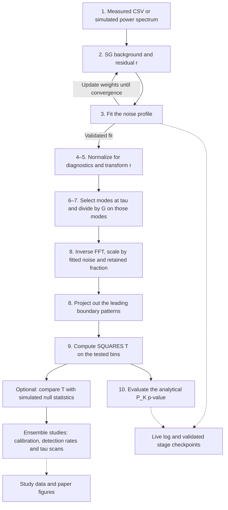

# MadmaxRuns

MadmaxRuns implements the SQUARES analysis from *Signal-agnostic search for narrow lines on unknown backgrounds*. It tests a measured or simulated power spectrum for a narrow excess after estimating the background and noise, whitening the residual, and removing boundary patterns.

## Features

- Analyze one measured CSV or simulate MADMAX-like spectra with homoscedastic or heteroscedastic noise and optional line injections.
- Use Savitzky–Golay or weighted Savitzky–Golay filtering, iterative noise fitting, Fourier-mode selection, and SVD boundary projection.
- Report the strongest SQUARES run, the corrected $P_K$ p-value, and a raw-residual $P_{BC}$ comparison. Optionally evaluate two Monte Carlo nulls with the same retained Fourier modes.
- Follow live progress, inspect saved intermediate arrays, and resume from validated checkpoints.
- Run ensembles for false-positive rates, detection rates, threshold scans, calibration histograms, and paper tables. Render the study data as PDF and PNG with the shared paper theme.

## Setup

Use Julia 1.12 for the pinned environments. Julia's `Project.toml` and `Manifest.toml` files declare and lock the dependencies for analysis, plotting, and the optional Jupyter kernel.

```bash
julia scripts/setup.jl            # analysis
julia scripts/setup.jl plots      # analysis and PDF/PNG export
julia scripts/setup.jl notebooks  # both environments and the MadmaxRuns Julia kernel
julia --project=. -t 4 test/runtests.jl
```

The notebook option registers **MadmaxRuns (Julia)** with IJulia. Use a Jupyter installation to open the notebooks. For full paper exports, install the DejaVu Serif font family.

Use `julia --project=. -t 4 scripts/selftest.jl` to run the tests and a small set of study smoke checks.

## Quick start

Run from the repository root.

```bash
julia --project=. -t 4 scripts/run_pipeline.jl model=hetero level=0.05 signal=3
julia --project=. -t 4 scripts/run_pipeline.jl input=myspectrum.csv
```

For measured data, use a headerless numeric CSV with one row per bin. Frequencies must be strictly increasing, uniformly spaced, and expressed in Hz. Use consistent linear units for power. These are example first rows of a longer spectrum.

```csv
4218000,68.12
4220000,67.94
4222000,68.31
```

A power-only CSV requires exactly 25,000 bins starting at 4.218 MHz with 2 kHz spacing. With default `n=4`, `m=64`, and `W=96`, the two-column format needs more than 256 bins and at least two full noise-fit windows.

One spectrum gives one observed SQUARES statistic and one corrected p-value at a fixed `tau` (default `1e-7`). The log also shows noise-fit convergence, removed modes, boundary singular values, and the strongest run. Set `nnull` and `nfilt` for optional Monte Carlo comparisons. Check p-value flatness across an ensemble of background-only spectra. Calibrate on representative instrument data before interpreting measured candidates.

## Analysis flow



The FFT uses the unweighted residual and transfer function. The fitted noise is applied after the inverse FFT. The filtered null uses the measured spectrum's fitted noise profile and follows the same filtering, Fourier mask, and boundary treatment. The i.i.d. null removes the same modes from unit Gaussian noise.

## Run outputs and recovery

The command-line workflows and paper notebook create these folders at startup.

```text
results/
├── logs/
├── data/
│   └── checkpoints/
└── paperplots/
```

| Folder | What to expect |
|---|---|
| `logs/` | Append-only progress and error messages. Use `tail -f results/logs/pipeline.log` during a single-spectrum run. |
| `data/` | Final mock or measured results, study `.jls` files, table CSV and LaTeX exports, and compressed stage checkpoints. |
| `paperplots/` | PDF and PNG pairs once the figure exporter runs. |

Use `output_root=...` for the pipeline or study CLI, or set `MADMAX_OUT` for command-line and batch workflows. Pipeline options `out=`, `checkpoint_dir=`, and `log=` can override individual paths. An empty `out=` skips the final result file. Study `outdir=` can point at an existing data directory.

Rerun the same pipeline command to resume. Invalid input or a failed noise fit stops scoring. The log identifies the failure and saved diagnostics. A damaged checkpoint causes its stage and successors to be recomputed. Changed inputs, options, or code start a separate checkpoint history. Use `resume=false` to recompute. Inspect trusted local checkpoints with `MadmaxRuns.load_checkpoint_file(path).data`.

Load a final result with `MadmaxRuns.load_result(path)`. Its `result` field includes the fitted noise, residual, whitened and projected spectra, SQUARES statistic, run bounds, and analytical p-values.

## Paper figures and studies

Open [paperplot.ipynb](paperplot.ipynb) to render existing study data or set `generate_studies = true` to compute them. The notebook and CLI both call `MadmaxRunsPlots.make_all` and share the repository's figure functions, panel sizes, colors, fonts, and export settings.

```bash
julia --project=. -t 4 scripts/run_study.jl filter resume=true
julia --project=plots plots/scripts/make_figures.jl
julia --project=plots plots/scripts/make_figures.jl --require-all
```

The second command previews available results. The third checks that every figure study is present before exporting. For a different data or plot directory, pass them as the first and second positional arguments. Full paper-scale studies are more expensive than a preview and use the same renderer. The original [Madmax_Runs-3.ipynb](Madmax_Runs-3.ipynb) is included for the earlier SQUARES workflow. Select the MadmaxRuns kernel manually when opening it.

| Studies | Outputs |
|---|---|
| `filter`, `background`, `spectra`, `sigmafit`, `iteration` | Filter response, input spectra, noise fits, convergence |
| `nobkg`, `examples`, `leakage`, `tolerance`, `boundary` | Example detections, line-shape tests, leakage and boundary diagnostics |
| `tauscan`, `tau0`, `correlation`, `fptp`, `pvalues`, `tcut` | Threshold scans, null comparisons, p-value calibration and run corrections |
| `table_a`, `table_b` | Detection fractions and Monte Carlo comparisons |

Use `julia --project=. scripts/run_study.jl list` for the study names. Use `quick=true` for smaller ensembles and `resume=true` to reuse compatible, verified outputs. The histogram study checkpoints each noise model, level, and threshold. It can stop if $P_K$ is invalid at a scan point, preserving the computed statistics. Use `taus=...` in the CLI or `study_overrides` in the notebook for a different scan. A quick run and a full study use different settings.

For staged runs, use `bash batch/run_local.sh 4` or configure the queue and resources in `batch/config.sh` and submit with `bash batch/pbs_all.sh`. PBS output goes to `results/logs/pbs`. The final stage merges table parts and requests a complete figure export.

## File tree

```text
MadmaxRuns/
├── Project.toml
├── Manifest.toml
├── README.md
├── Madmax_Runs-3.ipynb
├── paperplot.ipynb
├── notebooks/
│   ├── Project.toml
│   └── Manifest.toml
├── src/
│   ├── MadmaxRuns.jl
│   ├── model/
│   │   ├── grid.jl
│   │   ├── background.jl
│   │   ├── noise.jl
│   │   └── lineshapes.jl
│   ├── filter/
│   │   ├── savitzky_golay.jl
│   │   └── weighted_sg.jl
│   ├── noise/
│   │   └── estimate.jl
│   ├── whitening/
│   │   └── fourier.jl
│   ├── boundary/
│   │   ├── boundary.jl
│   │   └── tau0.jl
│   ├── stats/
│   │   ├── special.jl
│   │   ├── bivariate_normal.jl
│   │   ├── squares.jl
│   │   ├── pk.jl
│   │   └── pk_exact.jl
│   ├── pipeline/
│   │   ├── config.jl
│   │   ├── setup.jl
│   │   └── chain.jl
│   ├── nulls/
│   │   └── nulls.jl
│   ├── io/
│   └── studies/
├── scripts/
│   ├── setup.jl
│   ├── run_pipeline.jl
│   ├── run_study.jl
│   ├── selftest.jl
│   ├── merge_tables.jl
│   └── latex_table.jl
├── batch/
│   ├── config.sh
│   ├── jobs_stage1.txt
│   ├── jobs_stage2.txt
│   ├── pbs_array.sh
│   ├── pbs_single.sh
│   ├── pbs_finish.sh
│   ├── pbs_all.sh
│   └── run_local.sh
├── plots/
│   ├── Project.toml
│   ├── Manifest.toml
│   ├── src/
│   └── scripts/
│       └── make_figures.jl
└── test/
    └── runtests.jl
```
